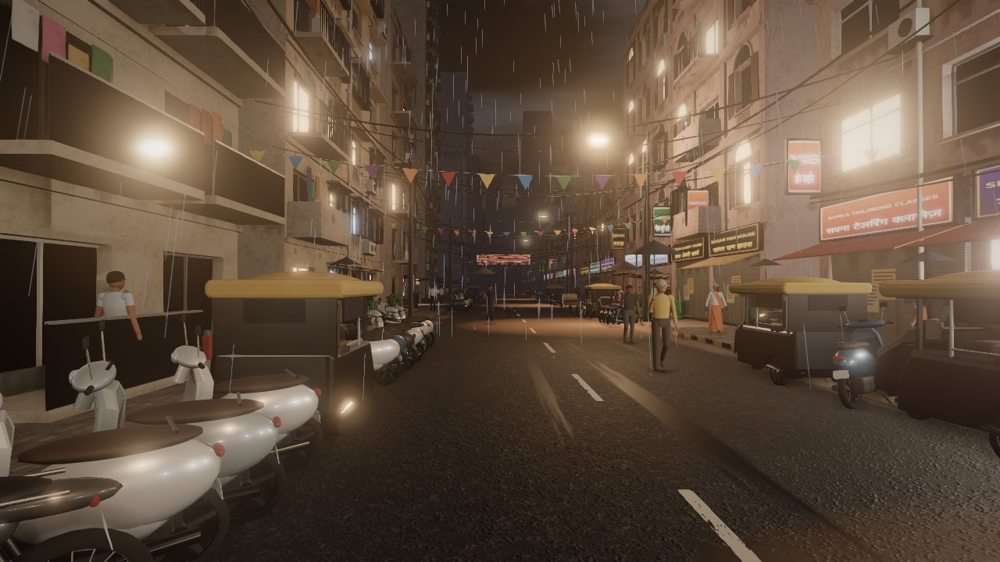
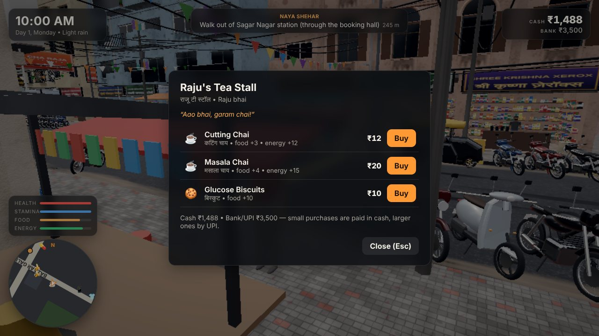
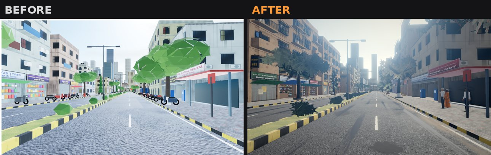
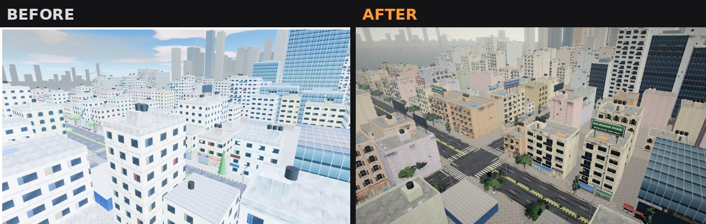
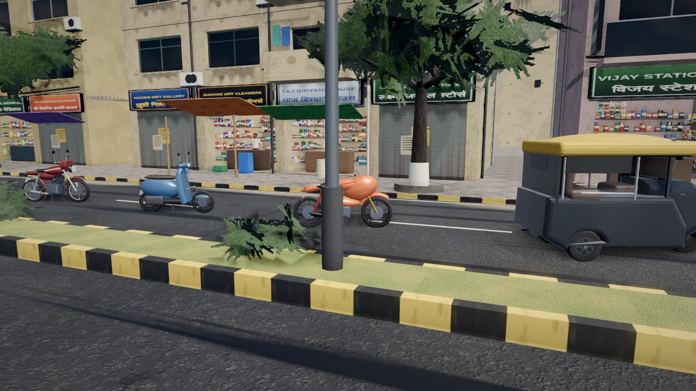
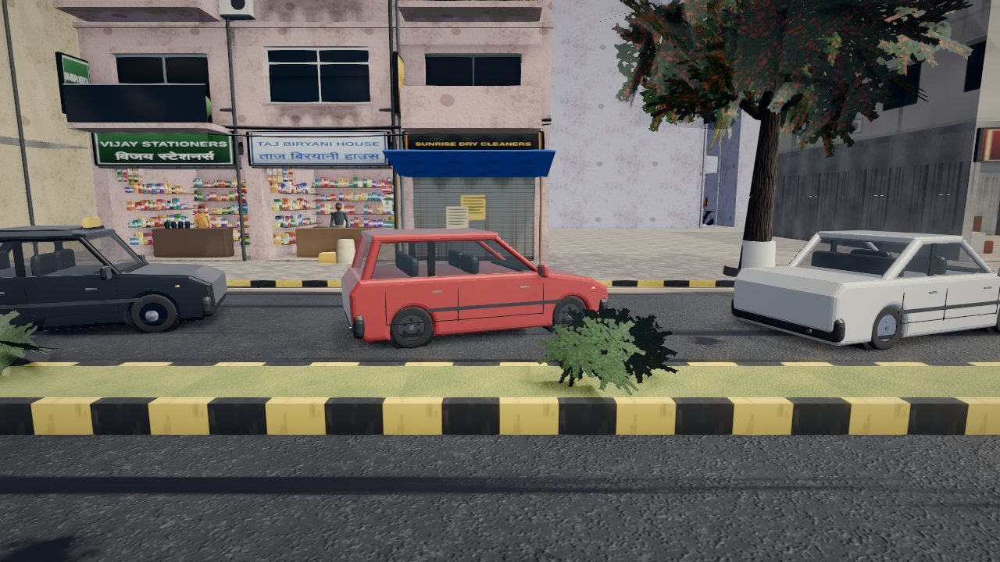

<div align="center">

# 🛺 BHARAT LIFE

### An open-world Indian city life simulator — Sagar Nagar, Mumbai

[](LICENSE)


Walk a crowded market lane, ride a scooter through left-hand traffic, catch the local train,
pay for cutting chai in rupees, take delivery gigs, rent a chawl room and build a life in the city.


</div>

> [!NOTE]
> **Honest positioning.** This is a **browser prototype (Three.js + TypeScript)**. Visuals are
> *stylised-realistic* — procedural PBR textures, geometric facades, CC0 HDRI lighting, ambient
> occlusion — **not photorealistic**, and characters are stylised placeholders (no realistic faces).
> The high-fidelity PC version is planned for **Unreal Engine 5**: see [`docs/UE5_PLAN.md`](docs/UE5_PLAN.md).

## Contents

- [Quick start](#-quick-start)
- [Controls](#-controls)
- [Features](#-features)
- [Screenshots](#-screenshots)
- [Project structure](#-project-structure)
- [Testing](#-testing)
- [Performance & hardware](#-performance--hardware)
- [Known limitations](#-known-limitations)
- [Roadmap](#-roadmap)
- [Credits & licensing](#-credits--licensing)

## 🚀 Quick start

**Requirements:** [Node.js](https://nodejs.org/) **22.12 or newer** (required by Vitest 5; Vite 8 alone needs 20.19+) and a desktop browser with hardware
acceleration enabled (Chrome or Edge recommended).

```bash
git clone https://github.com/yash262626/India.git
cd India
npm install
npm run dev
```

Open **http://localhost:5173**, click **New Game**, customise your character and start.
Click inside the game to capture the mouse; **Esc** releases it and pauses.

Production build:

```bash
npm run build      # type-checks, then bundles into dist/
npm run preview    # serves the build at http://localhost:4173
```

## 🎮 Controls

| On foot | | Driving | |
|---|---|---|---|
| **W A S D** / arrows | move (relative to camera) | **W / S** | throttle / brake, hold S to reverse |
| **Shift** | sprint (uses stamina) | **A / D** | steer |
| **Space** | jump | **Space** | handbrake |
| **C** | crouch | **H** | horn |
| **E** | interact — shops, ATM, fuel pumps, doors, trains | **L** | headlights |
| **F** | enter / exit vehicle | **Z / X** | indicators |
| **Mouse** | look around, wheel = zoom | **V** | chase / first-person camera |

**Tab** or **P** — phone (PaisaPay bank, Maps, DabbaDash gigs, Ghar Dekho property, My Garage, Missions, Messages)
· **M** — city map · **Esc** — pause menu (save, load, settings)

## ✨ Features

| | |
|---|---|
| **🏙️ District** | Bazaar Gali market street (shops, stalls, cable bundles, festival banners, parked two-wheelers, vendors), Tilak Marg arterial with median, Nehru Road, Gokhale Road, coastal Sagar Setu Marg and sea-face promenade with tetrapods, temple, park, maidan, chawl, office tower, mall, hospital, police chowki, petrol pump, garage, showroom, bus depot, self-built settlement. The edge of the map is closed by Metro construction hoardings. |
| **🌇 Rendering** | AgX filmic tone mapping, GTAO ambient occlusion, bloom, colour grading, SMAA, CC0 HDRI image-based lighting by time of day, sun shadows, day/night cycle, monsoon weather (rain, wet roads, reflections, storms with lightning and thunder), haze, lit windows and shop signs. |
| **🛵 Vehicles** | 17 fictional models — scooter, commuter and sport bikes, e-scooter, auto-rickshaw, hatchback, sedan, SUV, luxury car, sports car, kaali-peeli taxi, city bus, decorated truck, van, pickup, ambulance, police — each with its own handling, fuel use, damage, wet-road grip and collisions. GPU-instanced. |
| **🚦 Traffic AI** | Lane graph with left-hand driving, split-phase signals with a pedestrian phase, IDM car-following, junction-box discipline, two-wheelers filtering within lanes, honking, bus stops, visible riders and drivers. |
| **🚶 Pedestrians** | GPU-animated crowd (one draw call) walking footpaths and zebra crossings; vendors, shopkeepers and commuters; umbrellas in the rain; reactions to the player. |
| **🚆 Local trains** | Western-line style corridor with 4 stations and a foot over-bridge, two 6-coach trains, boarding and alighting, tickets and monthly pass, ticket-checker fines, platform announcements. |
| **₹ Economy** | Integer-paise wallet (cash + bank/UPI), Indian digit grouping (₹1,00,000), transaction ledger, ATM, rent, salary, gig pay, fuel, repairs, vehicle purchases. |
| **🏠 Life sim** | Needs (food, energy, stamina, health), Chapter 1 story missions, DabbaDash delivery gigs, office job with interview, shifts and promotions, room rental, sleeping, hospital. |
| **💾 Saving** | Versioned save files with checksum, field validation and repair, backup copy, three slots plus autosave. |
| **🔊 Audio** | Fully procedural (Web Audio): engines per vehicle class, horns, crows, city ambience, rain, thunder, train rumble, station chimes and optional speech-synthesis announcements. |

## 📸 Screenshots

| | |
|---|---|
|  |  |
| *Monsoon night, wet road reflections* | *Paying for chai in rupees* |
|  |  |
| *Tilak Marg — before / after* | *Aerial view — before / after* |
|  |  |
| *Bike, scooter, sport bike, auto-rickshaw* | *Kaali-peeli taxi, hatchback, sedan* |

More in [`docs/screenshots/`](docs/screenshots/).

## 🗂️ Project structure

```
src/
  core/        input, events, game clock, math
  config/      data tables: items, vehicles, shops, missions, economy (portable to UE5 DataTables)
  economy/     money formatting, wallet & ledger, inventory
  world/       layout (roads, blocks, landmarks), procedural textures & materials, facades, buildings,
               landmarks, props, railway geometry, collision world, environment (sky, weather, day/night)
  render/      renderer + post-processing chain, HDRI loading
  vehicles/    procedural models, instancing, physics, player vehicle manager
  traffic/     lane graph + signals, traffic AI
  npc/         human mesh + GPU crowd renderer, pedestrian system
  rail/        train model + train system
  player/      on-foot controller, camera rig
  shops/       shops, ATM, fuel, garage, showroom, tickets, hospital
  missions/    data-driven mission manager
  life/        property, career, delivery gigs
  save/        save/load with validation
  ui/          HUD, minimap & full map, modals, phone, menus, styles
  audio/       procedural audio
  game/        game orchestrator, setup & wiring, boot, settings
  dev/         fixed-camera preview mode for visual QA (?preview=1)
tests/         unit tests (Vitest)
scripts/       end-to-end smoke test, screenshot helpers
docs/          ASSETS.md, UE5_PLAN.md, ACCEPTANCE.md, screenshots/
```

## 🧪 Testing

```bash
npm test          # unit tests: economy, saving, missions, vehicle physics, road graph, clock, collision
npm run typecheck # TypeScript strict type-check
```

End-to-end acceptance test (headless Chromium, needs the dev server running in another terminal):

```bash
npm run dev
npm run smoke     # set CHROME=/path/to/chrome if Chromium is not at the default path
```

Latest results — **38/38 unit tests** and **16/16 end-to-end checks** — are recorded in
[`docs/ACCEPTANCE.md`](docs/ACCEPTANCE.md).

## ⚡ Performance & hardware

- Quality presets **Low / Medium / High / Ultra** in Settings; the first launch picks one from your GPU's name.
- **Not yet measured on a real GPU.** Development happened on a software renderer, which says nothing about
  real hardware. Expected (to be verified): High preset at 1080p around 45–60 FPS on a desktop RTX 3050.
- Low FPS? Lower the preset — ambient occlusion and shadows cost the most.

## 🚧 Known limitations

- Characters are stylised placeholders — no facial animation, lip-sync or ragdolls.
- Shops are open-front walk-in spaces; home and office interiors are menu-driven, not walkable rooms.
- Pedestrians walk through some street props; traffic doesn't change lanes or overtake.
- Only Sagar Nagar is fully built; the other stations are small enclosed plazas.
- Procedural textures are 512–1024 px; there is no photo-scanned detail.

## 🗺️ Roadmap

1. Measure performance on real hardware and tune the quality presets.
2. Drop-in slots for licensed 3D models (characters, vehicles, props), keeping the procedural ones as fallback.
3. Smarter crowds and traffic: prop avoidance, lane changes, overtaking.
4. High-fidelity PC version in Unreal Engine 5 — step-by-step plan in [`docs/UE5_PLAN.md`](docs/UE5_PLAN.md).

## 📜 Credits & licensing

- **Code:** [MIT License](LICENSE) © 2026 yash262626.
- **HDRI skies:** [Poly Haven](https://polyhaven.com/hdris) (CC0), via the
  [`@pmndrs/assets`](https://www.npmjs.com/package/@pmndrs/assets) package.
- **Everything else** — textures, buildings, vehicles, characters and audio — is generated procedurally
  by this project's code. Full manifest: [`docs/ASSETS.md`](docs/ASSETS.md).
- All brands, shops, places and characters are **fictional**; any resemblance to real businesses is coincidental.
