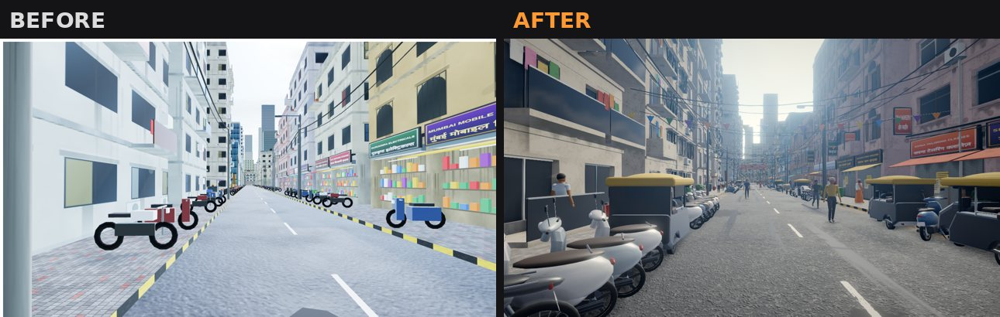

# BHARAT LIFE — Sagar Nagar (browser vertical slice)

An open-world Indian city life simulator prototype set in **Sagar Nagar**, a fictional Mumbai-inspired
neighbourhood: a dense market street, a suburban railway station, a sea-face promenade, traffic that
drives on the left, pedestrians, shops that take rupees, jobs, missions and saving.

> **Honest positioning.** This is a **Three.js / TypeScript browser prototype** built in an environment
> without a GPU or Unreal Engine. Visuals are *stylised-realistic*: procedural PBR textures, geometric
> facades, CC0 HDRI lighting, ambient occlusion — **not photorealistic**, and characters are stylised
> placeholders (no realistic faces). The high-fidelity PC version is planned for **Unreal Engine 5**;
> see [`docs/UE5_PLAN.md`](docs/UE5_PLAN.md). Asset licensing: [`docs/ASSETS.md`](docs/ASSETS.md).



## Quick start

Requirements: **Node.js 20+** and a desktop browser with hardware acceleration (Chrome or Edge recommended).

```bash
npm install
npm run dev          # http://localhost:5173  (development server)
# or a production build:
npm run build && npm run preview   # http://localhost:4173
```

Open the URL, click **New Game**, customise your character, and start. Click inside the game to
capture the mouse (Esc releases it / pauses).

### Controls

| On foot | | Driving | |
|---|---|---|---|
| WASD | move (relative to camera) | W / S | throttle / brake & reverse |
| Shift | sprint (uses stamina) | A / D | steer |
| Space | jump | Space | handbrake |
| C | crouch | H | horn |
| E | interact (shops, ATM, pumps, doors, trains) | L | headlights |
| F | enter / exit vehicle | Z / X | indicators |
| Mouse | camera, wheel = zoom | V | chase / first-person camera |

Tab / P = phone (PaisaPay bank, Maps, DabbaDash gigs, Ghar Dekho property, My Garage, Missions, Messages) •
M = city map • Esc = pause (save / load / settings).

## What is in the slice

* **District**: Bazaar Gali (hero market street: shops, stalls, cable bundles, banners, parked two-wheelers,
  vendors), Tilak Marg arterial with median, Nehru Road, Gokhale Road, coastal Sagar Setu Marg and
  promenade with tetrapods, temple, park, maidan, chawl, office tower, mall, hospital, police chowki,
  petrol pump, garage, showroom, bus depot, self-built settlement. Diegetic boundary: Metro construction hoardings.
* **Rendering**: AgX filmic tone mapping, GTAO ambient occlusion, bloom, colour grade, SMAA, CC0 HDRI
  image-based lighting by time of day, cascaded-style sun shadows, day/night cycle, monsoon weather
  (rain streaks, wet roads, puddle reflections, storms with lightning/thunder), fog/haze, lit windows and signs.
* **Vehicles**: 16 fictional models (scooter, commuter & sport bikes, e-scooter, auto-rickshaw, hatchback,
  sedan, SUV, luxury, sports car, kaali-peeli taxi, BEST-style bus, decorated truck, van, pickup,
  ambulance, police) with distinct handling, fuel, damage, wet grip, collisions; GPU-instanced.
* **Traffic AI**: lane graph with left-hand driving, split-phase signals with pedestrian phase, IDM
  car-following, junction-box discipline, two-wheeler lane filtering, honking, bus stops, riders.
* **Pedestrians**: GPU-animated crowd (one draw call) walking footpaths, zebra crossings, vendors,
  shopkeepers, commuters, umbrellas in the rain, reactions to the player.
* **Railway**: Western-line style corridor with 4 stations, 6-coach EMUs on two tracks, foot over-bridge,
  timetable-like shuttling, boarding/alighting, tickets, monthly pass, TC fines, announcements.
* **Economy**: integer-paise wallet (cash + bank/UPI), Indian digit grouping (₹1,00,000), ledger,
  ATM, rent, salary, gigs, fuel, repairs, vehicle purchase.
* **Life sim**: needs (food, energy, stamina, health), story missions (Chapter 1), DabbaDash delivery
  gigs, office job with interview/shifts/promotions, room rental, sleeping, hospital.
* **Save system**: versioned JSON, checksum, field validation/repair, backup slot, autosave.
* **Audio**: fully procedural (Web Audio): engines per vehicle class, horns, crows, city bed, rain,
  thunder, train rumble & rail-joint clack, station chimes + optional speech-synthesis announcements.

## Project structure

```
src/
  core/        input, events, game clock, math
  config/      data tables: items, vehicles, shops, missions, economy (portable to UE5 DataTables)
  economy/     money formatting, wallet/ledger, inventory
  world/       layout (roads/blocks/landmarks), procedural textures & materials, facades, buildings,
               landmarks, props, railway geometry, collision world, environment (sky/weather/day-night)
  render/      renderer + post-processing chain, HDRI loading
  vehicles/    procedural models, instancing, physics, player vehicle manager
  traffic/     lane graph + signals, traffic AI
  npc/         human mesh + GPU crowd renderer, pedestrian system
  rail/        train model + train system
  player/      on-foot controller, camera rig
  shops/       shop/ATM/fuel/garage/showroom/ticket services
  missions/    data-driven mission manager
  life/        property, career, delivery gigs
  save/        save/load with validation
  ui/          HUD, minimap/map, modals, phone, menus, styles
  audio/       procedural audio
  game/        Game orchestrator, setup/wiring, boot, settings
  dev/         preview mode for visual QA (?preview=1)
tests/         unit tests (vitest)
scripts/       smoke-test.mjs (end-to-end acceptance), shot.mjs / shots-visual.sh (screenshots)
docs/          ASSETS.md, UE5_PLAN.md, ACCEPTANCE.md, screenshots/
```

## Testing

```bash
npm test                 # unit tests: economy, save/validation, missions, vehicle physics, road graph, clock, collision
npm run dev &            # then, in another shell:
npm run smoke            # end-to-end acceptance test in headless Chromium (slow: software WebGL)
```

Results of the latest run are recorded in [`docs/ACCEPTANCE.md`](docs/ACCEPTANCE.md).

## Performance & hardware

* Quality presets: Low / Medium / High / Ultra (Settings). The first launch picks a preset from the GPU name.
* **Not yet measured on real GPUs.** The development container only has a software renderer
  (SwiftShader: ~0.4 FPS at Low), which says nothing about an RTX 3050. Expected targets
  (to be verified with your hardware): High preset at 1080p ≈ 45–60 FPS on a desktop RTX 3050 8 GB.
* If FPS is low: lower the preset (AO and shadows are the most expensive), or reduce browser zoom/resolution.

## Known limitations

* Characters are stylised placeholders; no facial animation/lip-sync; no ragdolls.
* Interiors: shops are open-front walk-in spaces; home/office interiors are menu-driven (no separate interior levels yet).
* Pedestrians don't avoid every street prop; traffic has no lane changes or overtaking.
* Only the Sagar Nagar district is fully built; other stations are small enclosed plazas.
* Procedural textures are 512–1024 px; no photo-scanned detail.
